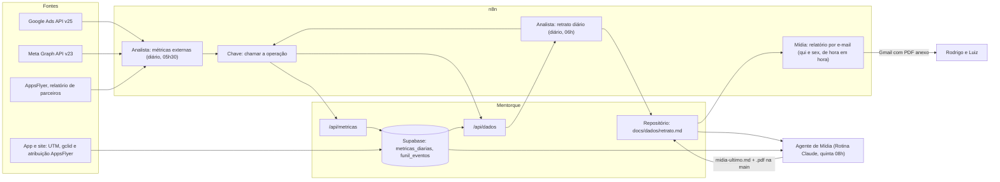

# Agente de Mídia paga do Mentorque: como funciona

Documento de referência do funcionamento completo do agente de Mídia paga e da
integração dele com o n8n, o banco e o repositório. Levantado em 07/11/2026 a
partir das próprias fontes: o manual do papel (`docs/agentes/midia-paga.md`),
a rotina agendada, a definição dos fluxos no n8n e o código.

Quando este documento e o manual discordarem, vale o manual: ele é o que o
agente lê a cada rodada.

## 1. O que o agente é

Um agente de IA (Claude) que cuida do dinheiro que sai em anúncio. Toda quinta
de manhã ele:

1. lê os números da semana;
2. calcula o **custo por conta criada medida no nosso banco**;
3. acha o desperdício com nome;
4. propõe no máximo uma melhoria;
5. entrega um relatório em PDF, que sai por e-mail para o Rodrigo e para o Luiz.

Ele **não mexe** em campanha, orçamento, lance, público ou região, e não escreve
nada nas contas do Google Ads ou do Meta. Ele mede, analisa e deixa o passo
pronto para o dono executar no console.

O número que justifica o papel é o **custo por desfecho medido**: o custo de uma
campanha dividido pelas contas que chegaram com a etiqueta (UTM) daquela
campanha, lidas no nosso banco. Ele não usa a conversão que o Google ou o Meta
dizem ter entregue.

## 2. Visão geral do caminho dos dados

Horários do n8n no fuso de Brasília.

## 3. Como o agente é disparado

| Item | Valor |
|---|---|
| Tipo | Rotina agendada do Claude ("Mídia paga, Mentorque, quinta 08h") |
| Horário | toda quinta às 08h de Brasília (`0 11 * * 4` em UTC) |
| Sessão | persistente: a mesma conversa continua de uma rodada para a outra, então o agente lembra do que mediu e recomendou |
| Repositório | `rod455/mentorque`, já clonado no ambiente da rotina |
| Última disparada | 05/11/2026 às 11h03 UTC |

A rotina manda, em resumo:

1. reler a rodada anterior na própria conversa;
2. dar `git pull`;
3. ler os documentos;
4. executar o ritual (seção 7);
5. gravar o relatório e o PDF e dar push;
6. publicar o artifact "Mídia da semana", registrar no `DIARIO.md` e anotar em
   `acoes-do-dono.md` o que depender do console.

O agente não notifica o dono. Quem consolida a semana é o Diretor, na segunda.

## 4. O que o agente lê, nesta ordem

1. `docs/agentes/DIRETRIZES.md` (regras do time)
2. `docs/agentes/midia-paga.md` (o manual do papel, com a régua e os direcionamentos do dono)
3. `docs/agentes/DIARIO.md` (o que o time fez)
4. `.claude/skills/ler-a-operacao` (a régua de todo número)
5. `docs/utms.md` (a convenção de etiqueta e os links prontos)
6. `docs/dados/retrato.md` (os números do dia, já coletados)
7. `docs/agentes/acoes-do-dono.md` (o que está parado esperando o console)

As skills do Google (`google-ads-api-*`, `data-manager-api-*`) moram em
`.claude/skills/` e carregam sozinhas quando o assunto encosta nelas. Elas ensinam
a API do Google, não a nossa régua.

## 5. A coleta no n8n

### 5.1 O coletor: "Mentorque | Analista: métricas externas"

Roda todo dia às 05h30. O mesmo fluxo coleta várias fontes; as de mídia são
Google Ads, Meta e AppsFlyer. Cada fonte tem nós de pedido, um nó "normaliza"
que monta o pacote, e o nó "Grava na mesa de métricas".

**Google Ads** (API v25, credencial OAuth do Google Ads guardada no n8n):

| Nó | O que pergunta |
|---|---|
| contas acessíveis | `customers:listAccessibleCustomers`, e um nó de código escolhe a conta do Mentorque |
| custo 7 dias | por campanha, dia e rede: custo, cliques, impressões, interações, conversões, status e tipo de canal (`advertising_channel_type`) |
| termos de busca | `search_term_view` dos últimos 30 dias, os 50 com maior custo |
| ações de conversão e anúncios | duas consultas no mesmo nó: as ações de conversão por campanha, e o estado de aprovação de cada anúncio (`approval_status`, `review_status`) |

O pacote `google_ads` sai com estes campos:
- `custo7d`, `porDia`, `porCampanha`, `porCampanhaPorDia` e `porRede`;
- `termos` e `termosSemConversao`;
- `acoesDeConversao`;
- `anuncios`, `anunciosAtivos`, `anunciosReprovados` e `anunciosLimitados`;
- `fatiaDeBusca`, `nota` e `erro`.

**Meta** (Graph API v23, token de acesso guardado no n8n):

| Nó | O que pergunta |
|---|---|
| contas de anúncio | as contas que o token lê, com campanhas e conjuntos (status, objetivo, orçamento diário) |
| gasto e resultados 7 dias | `insights` em nível de anúncio, por dia, até 500 linhas: gasto, impressões, cliques, ações, nomes de campanha, conjunto e anúncio |

O pacote `meta_ads` sai com estes campos:
- `gasto7d` e `moeda`;
- `porDia`, `porCampanha` e `porAnuncio`;
- `campanhas`, `conta` e `contaLida`;
- `truncado`, que avisa quando as 500 linhas encheram;
- `erro`.

**AppsFlyer** (token guardado no n8n): o relatório de parceiros dos últimos 7
dias, para o Android e para o iPhone. O n8n **não lê** o CSV: ele entrega os
dois arquivos crus, e a leitura é feita no repositório (`lib/appsflyer.ts`),
onde existe conferência que planta defeito. O motivo está escrito no nó: os
erros que quebram calados são justamente de leitura:
- vírgula dentro do campo desloca coluna;
- "N/A" lido como zero vira "foi de graça";
- texto de erro lido como tabela vazia vira "zero instalação".

### 5.2 Gravação: a chave fica num lugar só

Nenhum coletor tem a chave da API do Mentorque. O nó de gravação chama o fluxo
**"Mentorque | Chave: chamar a operação"**, que é o único com essa credencial.
Ele só aceita caminhos `/api/` do próprio Mentorque.

A rota `/api/metricas` recebe um pacote por fonte e por dia e grava em
`metricas_diarias`. A chave da tabela é dia mais fonte, e o pacote novo grava
por cima. Ela recusa fonte desconhecida e pacote acima de **20.000 bytes**
(resposta 413).

**Armadilha conhecida:** uma execução verde no n8n não prova gravação. O nó de
gravação segue em frente quando dá erro. O que prova que gravou é a data
`coletado_em` da linha no banco.

### 5.3 Do banco ao retrato: "Mentorque | Analista: retrato diário"

Roda todo dia às 06h e faz quatro coisas:
1. chama `/api/dados` e `/api/avaliacoes` pelo fluxo da chave;
2. monta `docs/dados/retrato.md`;
3. passa por um nó que troca as linhas do Play pela frase legível;
4. faz commit na `main` pela API do GitHub.

O `/api/dados` já entrega para a Mídia, prontos:

| Campo | O que é | Onde mora a regra |
|---|---|---|
| `fontesExternas` | os pacotes de 30 dias por fonte (`google_ads`, `meta_ads`, `appsflyer` e as outras) | `/api/metricas` |
| a linha de gasto | o gasto dito com a janela real, o ritmo dos últimos dias contra os primeiros e a data da leitura. Impressão caindo com gasto parecido vira aviso de suspeita de campanha parando | `lib/midiaLegivel.ts` |
| `aquisicao` (a escada da aquisição) | cada degrau com um único dono. Não soma painel com painel, não usa "conversão do Google" como instalação, e degrau sem dono devolve vazio com o motivo | `lib/aquisicao.ts` |
| `marketing.cadastrosPorCampanha` | contas novas de 28 dias por origem e campanha (UTM) | `lib/operacao.ts` |

### 5.4 O vigia de anomalias

O fluxo **"Mentorque | Vigia de anomalias"** roda as consultas de
`supabase/anomalias-da-operacao.sql`. Para a Mídia, ele detecta, por exemplo,
campanha com queda forte de impressões ou com zero impressões estando ativa. O
texto que ele gera aparece nas anomalias do retrato ("Confira anúncio
reprovado antes de orçamento").

## 6. Como a origem de cada conta é medida (o lado do app)

- **Site e web:** a UTM e o `gclid` da chegada "grudam" (`lib/app/campanha.ts`).
  Uma chegada sem etiqueta não apaga a etiqueta que já existia. O `gclid` é o
  que permite devolver a conversão ao Google.
- **App das lojas:** campanha de instalação manda o clique direto para a loja, e
  ali não existe UTM. A origem vem da AppsFlyer, dentro do app
  (`lib/app/atribuicao.ts`, evento `onConversionDataSuccess`). Ela é gravada na
  conta e no funil desde a 3.3 (29/10/2026).
- **No banco:**
  - a origem fica em `funil_eventos`, no evento `cadastro`, em `extra->'utm'->>'utm_source'`;
  - as contas novas vêm de `public.contas_criadas_desde('aaaa-mm-dd')`, que devolve um número e não uma lista;
  - as etapas vêm de `public.funil_canonico('aaaa-mm-dd')`.

## 7. O ritual da quinta

1. `git pull` e leitura dos documentos da seção 4.
2. **Fechar o que ficou aberto.** Cada recomendação da semana anterior recebe
   desfecho. Se ela continua parada na lista do dono, o agente diz o custo
   acumulado da espera, em vez de repetir a recomendação.
3. **A conta da semana, com a janela dita:**
   - custo total, por campanha, e o CPC;
   - **custo por desfecho medido** (custo da campanha dividido pelas contas com
     a etiqueta dela, no nosso banco);
   - a diferença entre a conversão que a plataforma conta e o desfecho que a
     gente mede.
4. **O desperdício com nome:** termos de busca com custo e sem desfecho,
   **agrupados por assunto**. Termo solto não é achado.
5. **No máximo uma proposta nova**, com o número do lado.
6. **A rodada se mede contra a régua** (seção 8) e diz qual critério não
   cumpriu.
7. **Entrega:**
   - relatório e PDF na `main`;
   - artifact "Mídia da semana";
   - entrada no `DIARIO.md`;
   - ações no `acoes-do-dono.md`;
   - aprendizados no manual.

## 8. A régua da rodada (12 critérios)

| # | Critério |
|---|---|
| 1 | A manchete é o maior número da semana |
| 2 | Todo número tem janela e régua (período e fonte) |
| 3 | A conta do papel está fechada: custo dividido por contas medidas no nosso banco |
| 4 | A semana anterior está do lado |
| 5 | Amostra pequena avisa |
| 6 | O desperdício tem nome e grupo |
| 7 | O que ficou aberto na semana passada recebeu desfecho |
| 8 | No máximo uma proposta nova, e ela tem número |
| 9 | Toda ação diz de quem é e quando vale |
| 10 | O que a medição não alcança está dito |
| 11 | O PDF se sustenta sozinho para quem é de fora |
| 12 | Nada fora da alçada foi tocado |

Falhar um critério com o motivo escrito é rodada honesta. Falhar em silêncio é
o que a régua existe para impedir. Quem confere de fora é o Diretor, na
segunda, e o dono lendo o artifact.

## 9. A entrega por e-mail

### 9.1 O que o agente faz

1. Grava `docs/agentes/relatorios/midia-ultimo.md`, sobrescrevendo o anterior.
   A **primeira linha** tem de ser exatamente
   `Relatório de mídia gerado em AAAA-MM-DD`.
2. Roda `npm run relatorio:pdf`, que gera o `.pdf` ao lado, claro e com o âmbar
   da marca. A conversão mora em `lib/relatorio/markdown.ts` e entende
   título, parágrafo, lista, tabela e negrito.
3. Faz commit e push dos dois arquivos. **Sem o PDF na `main`, nada sai.**

O texto é escrito sabendo que sai da casa:
- português natural, sem travessão;
- sem chave nem segredo;
- sem dado de cliente nominal.

### 9.2 O fluxo "Mentorque | Mídia: relatório por e-mail"

| Item | Valor |
|---|---|
| Quando | quinta e sexta, de hora em hora, das 10h às 18h de Brasília (no minuto 5 de cada hora) |
| O que busca | o `.md` e o `.pdf` em `raw.githubusercontent.com`, na `main` |
| Quando manda | relatório datado de **hoje ou de ontem**, com o PDF presente, e que ainda não foi enviado |
| Como evita duplicar | guarda no estado do fluxo a data do último relatório enviado; a mesma data nunca sai duas vezes |
| Para quem | Rodrigo e Luiz, pelo Gmail, com remetente "Mídia Mentorque" e o anexo `mentorque-midia-AAAA-MM-DD.pdf` |
| Quando falta | só na última tentativa da semana (sexta às 18h), um aviso **só para o Rodrigo** dizendo o motivo: relatório velho, sem a linha de data ou sem o PDF |

**Por que de hora em hora (08/10/2026).** Com uma tentativa fixa por dia, a
entrega dependia de a rodada terminar antes daquela hora. Assim, o PDF sai na
hora cheia seguinte ao push.

**Limite conhecido.** Antes da sexta às 18h, a falta de relatório é silenciosa:
o fluxo roda verde e não manda nada. "Execução verde" não prova envio. O que
prova é o nó "Manda o relatorio com o PDF" ter rodado e devolvido a mensagem
como enviada.

### 9.3 A conferência da entrega

A rodada confere a entrega da semana **anterior** nas execuções do fluxo no n8n
e escreve no diário o id da execução. Sobre a semana corrente, a frase certa é
"sai na próxima hora cheia depois do push", nunca "chegou".

## 10. Investigações avulsas pela API (além da coleta)

A coleta é uma lista fixa de perguntas que alguém escreveu uma vez. Quando um
número surpreende, a regra do papel é **perguntar à fonte antes de pedir clique
ao dono**. Como a credencial do Google Ads está no n8n, o agente cria um fluxo
temporário, faz a pergunta e arquiva o fluxo no mesmo dia.

Consultas que já funcionaram na v25:
- `campaign.primary_status` e `campaign.primary_status_reasons`, para saber se
  a campanha está apta e por quê. Atenção: `ELIGIBLE` descarta causas, mas não
  prova que ela está entregando;
- `change_event`, que diz **quem mudou o quê e quando** na conta, com o valor
  antigo e o novo, nos últimos 30 dias. Filtro de data e `LIMIT` são
  obrigatórios.

Limitação da ferramenta: o MCP do n8n não anexa credencial em nó novo. Para
consultas fixas, a saída usada foi fazer o nó que já tem a credencial ("Google
Ads: ações de conversão") rodar uma lista de consultas.

## 11. Alçada

| Pode sozinho | Não pode (vira recomendação com número) |
|---|---|
| ler tudo, medir e escrever a análise | orçamento, lance, pausar ou criar campanha |
| propor palavra-chave negativa, com o custo que ela teria evitado | mudar público ou região |
| mexer em texto e destino de link do nosso lado (UTM, LP) | qualquer escrita na conta do Google Ads ou do Meta |
| registrar ação na lista do dono | preço, plano ou oferta |

A assimetria: o que só pode diminuir o gasto é autonomia barata; o que pode
aumentar a conta é do dono.

## 12. O que a medição não alcança (e o agente tem de dizer)

- **A conversão do Google não é desfecho.** Zero conversão no Google nunca se lê
  como "a campanha não traz ninguém". A conversão mede o que o lance aprende,
  não o que o negócio ganhou.
- **Campanha de instalação não passa pelo nosso site.** Zero UTM ali é o
  esperado. A origem vem só da AppsFlyer.
- **A AppsFlyer serve para proporção, não para total.** Ela só vê os aparelhos
  onde o SDK subiu.
- **Painel somado com painel conta a mesma pessoa duas vezes.**
- **`porCampanha` só lista quem gastou na janela.** Campanha pendente, em
  rascunho ou pausada antes de gastar não aparece.
- **Meta:** a coleta só vê as contas que o token lê. Rascunho não existe para a
  API, e "edição não publicada" entrega a versão antiga do anúncio.
- **Instagram orgânico não tem medição.** Não existe fonte de post no banco.
- **Amostra pequena é direção, não lei.** Uma ou duas contas a mais mudam o
  custo por conta.

## 13. As conferências que protegem esse caminho

Rodam em `npm run conferir`, antes de cada push:

| Conferência | O que ela impede |
|---|---|
| `conferir:midia` | a frase de gasto esconder campanha parada dentro da janela |
| `conferir:campanha` | a etiqueta de origem não grudar, ou ser apagada por uma chegada sem etiqueta |
| `conferir:aquisicao` | a escada da aquisição somar painéis ou usar número de outro dono |
| `conferir:appsflyer` | o remendo do plugin da AppsFlyer sumir e quebrar o build do iPhone |
| `conferir:relatorio` | a conversão do relatório para PDF quebrar |
| `conferir:anomalias` | o vigia da operação parar de perguntar o que pergunta |

## 14. Estado em 07/11/2026

- A rodada de 05/11 gravou o relatório datado de 07/11 (commit `9c6d00d`, 07/11
  às 12h03 UTC). Manchete: o vídeo do Google parou de entregar sozinho em 31/10,
  com a causa lida na API.
- O e-mail desse relatório saiu na execução **9663** do fluxo, em 07/11 às 12h03
  UTC, com o PDF anexo. Foi um sábado, fora do horário agendado: o fluxo foi
  disparado à parte, e não conferi por quem.
- **Divergência a corrigir:** o texto da rotina agendada ainda fala em "e-mail
  das 10h", mas o fluxo manda de hora em hora, quinta e sexta, das 10h às 18h.
  Quem vale é o fluxo.

## 15. Onde mexer, se precisar

| O quê | Onde |
|---|---|
| comportamento e régua do agente | `docs/agentes/midia-paga.md` |
| instrução que dispara a rodada | a rotina agendada "Mídia paga, Mentorque" (configurações das rotinas no Claude) |
| perguntas feitas ao Google Ads, Meta e AppsFlyer | n8n, fluxo "Analista: métricas externas", nós de cada fonte |
| leitura do CSV da AppsFlyer | `lib/appsflyer.ts` |
| frase de gasto e escada da aquisição | `lib/midiaLegivel.ts` e `lib/aquisicao.ts` |
| captura de UTM e atribuição no app | `lib/app/campanha.ts` e `lib/app/atribuicao.ts` |
| PDF | `lib/relatorio/markdown.ts`, `npm run relatorio:pdf` |
| destinatários, horário e texto do e-mail | n8n, fluxo "Mídia: relatório por e-mail", nó "Decide e monta o e-mail" |
